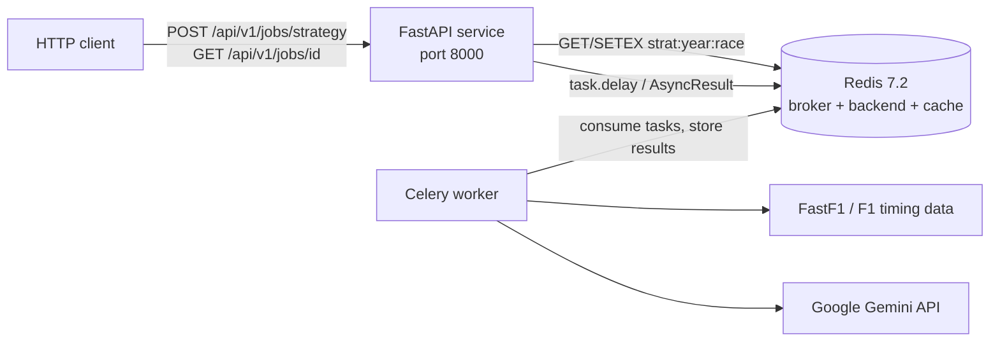
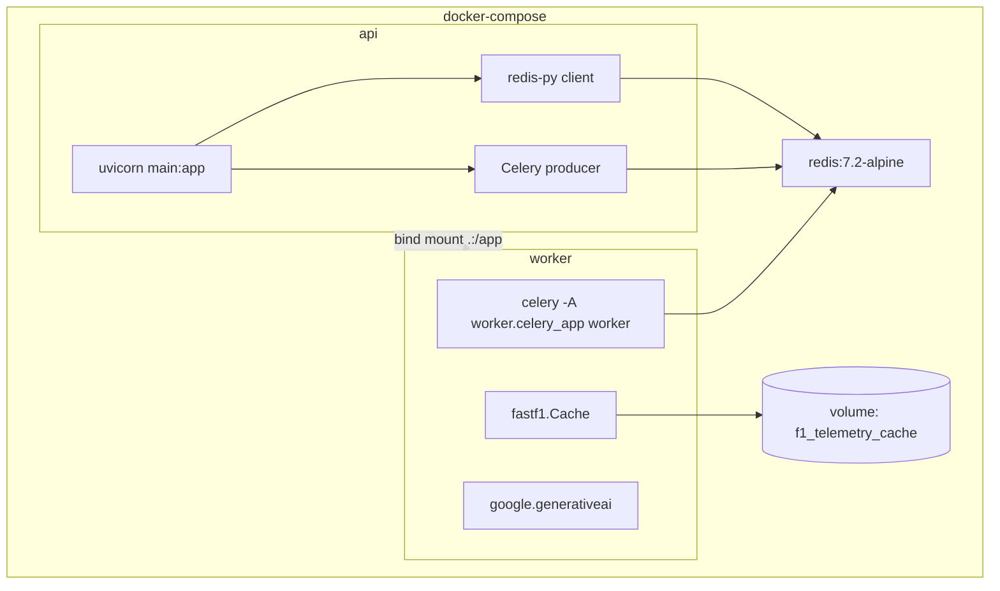
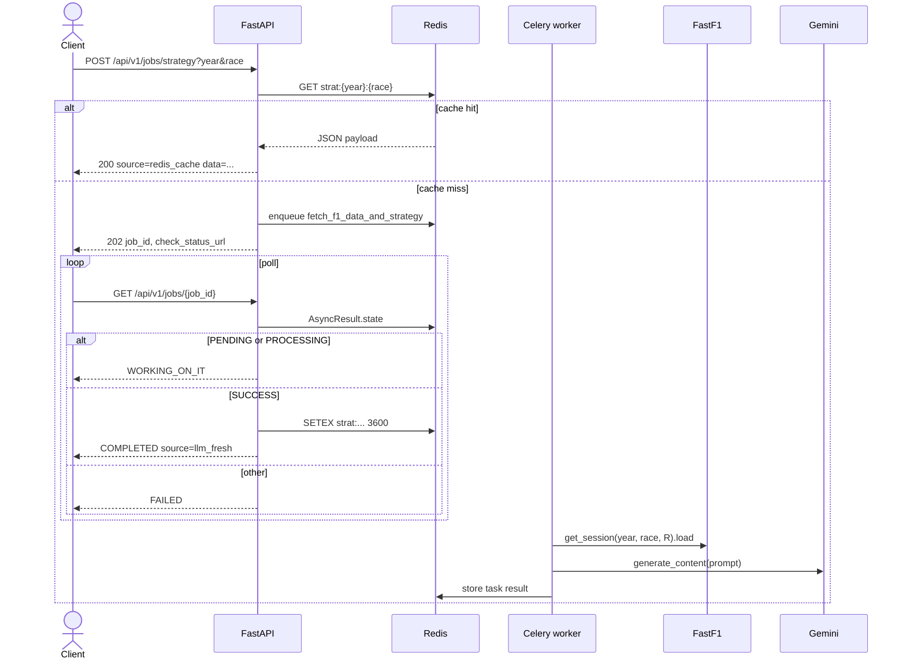

# PitWall AI — System Specification

**Document type:** Technical specification  
**Scope:** Current repository as implemented  
**Runtime:** Python 3.11, FastAPI, Celery, Redis, FastF1, Google Gemini, Docker Compose

This document describes the system as it exists in code. It is not a product vision paper.

---

## 1. Purpose

PitWall AI is an asynchronous HTTP service that produces a short “race engineer” radio message for a given Formula 1 season year and race name.

For each request it:

1. Loads official session data via FastF1 (race session, fastest lap, driver, compound).
2. Prompts Gemini with those facts.
3. Returns structured JSON to the caller.

The slow path (telemetry load + LLM) is offloaded to a Celery worker. Redis is used as:

- Celery **broker**
- Celery **result backend**
- Application **response cache** (1 hour TTL)

The design goal is to avoid repeating expensive LLM calls for the same `(year, race)` pair.

---

## 2. System context



External systems:

| System | Role | Auth |
| --- | --- | --- |
| FastF1 | Historical session/lap data | Optional `F1_USERNAME` / `F1_PASSWORD` (worker env) |
| Google Gemini | Natural-language strategy text | `GEMINI_API_KEY` |
| Redis | Queue, results, HTTP cache | Unauthenticated on Compose network (dev) |

---

## 3. Logical architecture

Three Compose services share one application image (API and worker) plus an official Redis image.



### 3.1 Component responsibilities

| Component | Process | Source | Responsibility |
| --- | --- | --- | --- |
| API | `uvicorn main:app --host 0.0.0.0 --port 8000` | `main.py` | Cache lookup, job dispatch, job polling, write-through cache on success |
| Worker | `celery -A worker.celery_app worker --loglevel=info` | `worker.py` | FastF1 load, Gemini generation, return payload |
| Redis | `redis:7.2-alpine` | image | DB 0 used for broker, backend, and `strat:*` keys |
| FastF1 disk cache | named volume `f1_telemetry_cache` → `/app/f1_cache` | Compose | Persist FastF1 downloads across container restarts |

### 3.2 Why the API and worker are split

FastF1 session load and Gemini generation are latency-heavy and can fail independently of HTTP. The API returns **202** on cache miss and never blocks the request thread on those calls. The worker is the only process that should talk to FastF1 and Gemini.

---

## 4. Request lifecycle



Cache is **not** written by the worker. It is written by the API on the first successful poll (`GET /api/v1/jobs/{job_id}` when state is `SUCCESS`). Until someone polls a completed job, subsequent POSTs for the same race can still miss the cache and enqueue duplicate work.

---

## 5. HTTP API

Base URL (local Compose): `http://localhost:8000`  
Framework: FastAPI (`title="PitWall AI"`)  
No authentication.

### 5.1 Request a strategy

`POST /api/v1/jobs/strategy`

| Query param | Type | Default | Notes |
| --- | --- | --- | --- |
| `year` | `int` | `2023` | Season year passed to FastF1 |
| `race` | `str` | `"Monza"` | Race identifier; lowercased only for the cache key |

**Status codes**

- `202` is declared on the route, but a **cache hit returns 202 with a body that already contains `data`** (FastAPI does not override status on the cache-hit branch). Treat the `source` field as the real discriminator, not the HTTP status.

**Cache hit body**

```json
{
  "source": "redis_cache (0 tokens spent!)",
  "job_id": null,
  "data": {
    "year": 2023,
    "race": "Monza",
    "driver": "VER",
    "lap_time": "1:25.340",
    "compound": "SOFT",
    "ai_strategy": "..."
  }
}
```

**Cache miss body**

```json
{
  "source": "queue_dispatched",
  "job_id": "<celery-uuid>",
  "check_status_url": "/api/v1/jobs/<celery-uuid>"
}
```

### 5.2 Poll a job

`GET /api/v1/jobs/{job_id}`

| Task state | Response |
| --- | --- |
| `PENDING` or `PROCESSING` | `{ "status": "WORKING_ON_IT" }` |
| `SUCCESS` | `{ "status": "COMPLETED", "source": "llm_fresh", "data": <task result> }` and cache write |
| anything else | `{ "status": "FAILED" }` |

`PROCESSING` is checked in the API but the worker never calls `self.update_state`. Typical Celery states observed will be `PENDING`, `STARTED` (if enabled), `SUCCESS`, `FAILURE`, `RETRY`. `STARTED` currently maps to `FAILED` because it is not in the success or in-progress branches.

---

## 6. Domain payload

Produced by `fetch_f1_data_and_strategy` in `worker.py`:

| Field | Type | Source |
| --- | --- | --- |
| `year` | int | Request |
| `race` | str | Request (original casing) |
| `driver` | str | Fastest-lap `Driver`, or `"VER"` on FastF1 error |
| `lap_time` | str | Fastest-lap `LapTime` last token, or `"1:25.340"` |
| `compound` | str | Fastest-lap `Compound`, or `"SOFT"` |
| `ai_strategy` | str | Gemini text, or a missing-key warning string |

On FastF1 failure the worker **does not fail the task**. It substitutes placeholder telemetry and still calls Gemini (if a key is present). Callers cannot distinguish a real lap from the fallback without extra checks.

---

## 7. Caching

### 7.1 Redis application cache

| Item | Value |
| --- | --- |
| Key | `strat:{year}:{race.lower()}` |
| Value | JSON serialization of the domain payload |
| TTL | 3600 seconds |
| Write | API, on successful job poll |
| Read | API, on POST |

Race names that differ only by case share a key (`Monza` / `monza`). Different spellings (`Monza` vs `Italian Grand Prix`) do not.

### 7.2 FastF1 file cache

Directory `/app/f1_cache` inside API and worker containers, backed by Docker volume `f1_telemetry_cache`. Reduces repeat downloads of timing data. Independent of the Redis strategy cache.

### 7.3 Celery result backend

Task results remain in Redis according to Celery defaults (not explicitly configured in code). Job poll requires the result to still be present.

---

## 8. Worker algorithm

```
fetch_f1_data_and_strategy(year, race):
  try:
    session = fastf1.get_session(year, race, 'R')
    session.load(telemetry=False, weather=False)
    fastest = session.laps.pick_fastest()
    driver, lap_time, compound = from(fastest)
  except:
    driver, lap_time, compound = VER, 1:25.340, SOFT

  if GEMINI_API_KEY missing:
    strategy = warning string
  else:
    prompt = race-engineer radio, 2 sentences, tire management + pushing
    model = gemini-3.8-flash
    strategy = generate_content(prompt).text.strip()

  return { year, race, driver, lap_time, compound, ai_strategy }
```

Prompt contract (implemented):

> You are the Race Engineer for `{driver}` at the `{year}` `{race}` Grand Prix. Your driver just set a fastest lap of `{lap_time}` on `{compound}` tires. Give a short, urgent 2-sentence radio message about tire management and pushing.

---

## 9. Configuration

Loaded from the process environment. Compose injects values from the host `.env` file.

| Variable | Used by | Required for happy path |
| --- | --- | --- |
| `REDIS_URL` | API, worker | Yes. Compose: `redis://redis:6379/0`. Default if unset: `redis://localhost:6379/0` |
| `GEMINI_API_KEY` | Worker (configure + generate). API receives it but does not call Gemini | Yes for real `ai_strategy` |
| `F1_USERNAME` | Worker only | Optional; FastF1 live-timing auth if required |
| `F1_PASSWORD` | Worker only | Optional |

Secrets must not be committed. `.env` is local configuration only.

---

## 10. Deployment topology (local)

`docker-compose.yml` `version: '3.8'`

| Service | Image / build | Ports | Volumes | Depends on | Command |
| --- | --- | --- | --- | --- | --- |
| `redis` | `redis:7.2-alpine` | `6379:6379` | — | — | image default |
| `api` | build `.` | `8000:8000` | `.:/app`, `f1_telemetry_cache:/app/f1_cache` | `redis` | Dockerfile CMD (uvicorn) |
| `worker` | build `.` | none | same | `redis` | `celery -A worker.celery_app worker --loglevel=info` |

Dockerfile:

- Base: `python:3.11-slim`
- Installs `requirements.txt`
- Copies `main.py` only into the image
- Default CMD: uvicorn

At runtime both API and worker bind-mount the project directory over `/app`, so `worker.py` is available even though it is not in the image COPY. A deploy **without** that bind mount would start a worker that cannot import `worker.py`.

Python dependencies (`requirements.txt`):

- `fastapi==0.110.0`
- `uvicorn==0.28.0`
- `fastf1` (unpinned)
- `pandas` (unpinned; FastF1)
- `celery==5.3.6`
- `redis==5.0.3`
- `google-generativeai` (unpinned)

---

## 11. Failure modes and known gaps

| Issue | Behavior today |
| --- | --- |
| FastF1 exception | Silent fallback telemetry; task still succeeds |
| Missing Gemini key | Task succeeds with warning string in `ai_strategy` |
| Gemini / model errors | Uncaught → Celery `FAILURE` → poll returns `FAILED` |
| Cache written only on poll | Duplicate enqueue if nobody GETs a finished job |
| Duplicate POSTs before cache fill | Multiple workers can run the same year/race |
| Celery `STARTED` / `FAILURE` / `RETRY` | Non-PENDING/PROCESSING/SUCCESS → `FAILED` (no error body) |
| HTTP 202 on cache hit | Status code does not distinguish hit vs miss |
| Redis exposed on host `:6379` | Fine for local dev; not a production posture |
| No auth, rate limit, or input validation | Any caller can enqueue work |
| Dockerfile COPY incomplete | Relies on Compose bind mount for worker source |

---

## 12. File map

| Path | Role |
| --- | --- |
| `main.py` | FastAPI app, Redis cache, Celery dispatch and poll |
| `worker.py` | Celery app, FastF1, Gemini task |
| `Dockerfile` | API (and worker) image |
| `docker-compose.yml` | Local three-service stack |
| `requirements.txt` | Python dependencies |
| `.env` | Local secrets (not for documentation or git) |
| `README.md` | Informal overview |
| `SPECIFICATION.md` | This document |

---

## 13. Local verification

```bash
docker compose up --build
```

Cache miss then poll:

```bash
curl -X POST "http://localhost:8000/api/v1/jobs/strategy?year=2023&race=Monza"
curl "http://localhost:8000/api/v1/jobs/<job_id>"
```

Cache hit (same year/race within TTL, after at least one successful poll):

```bash
curl -X POST "http://localhost:8000/api/v1/jobs/strategy?year=2023&race=Monza"
```

Expect `source` to contain `redis_cache`.
